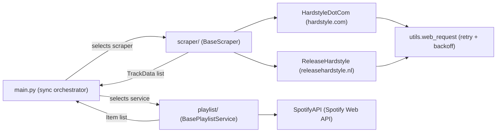

# Hardstyle Sonar

Scraping + synchronization program behind the Hardtsyle playlist, [Hardstyle Sonar](https://open.spotify.com/playlist/0J4ajfoQIajAnderVJZDgl?si=ebe5d9dda5af4ea9).

## System Design

Hardstyle Sonar is a batch pipeline that keeps a Spotify playlist in sync with newly released hardstyle tracks. It consists of three loosely coupled layers: **scrapers** that discover new releases, a **playlist service** that talks to the Spotify Web API, and a thin **orchestration** layer that ties them together.

### Architecture Overview

### Components

| Component | Location | Responsibility |
|-----------|----------|----------------|
| Orchestrator | `main.py` | Runs the sync pipeline: init scraper, fetch tracks, resolve Spotify URIs, diff playlist, apply changes. Also configures logging (stdout + a timestamped file under `logs/`). |
| Scraper layer | `scraper/` | Pluggable, source-specific scrapers. `BaseScraper` (ABC) defines the `fetch_tracks() -> List[TrackData]` contract; `HardstyleDotCom` and `ReleaseHardstyle` implement it for their respective websites. |
| Track model | `scraper/models/track_data.py` | `TrackData` value object (title, artist name, release date, genre, optional Spotify URI) with `__hash__`/`__eq__` so tracks can be de-duplicated and diffed with set operations. |
| Playlist layer | `playlist/` | `BasePlaylistService` (ABC) defines the playlist contract (`get_playlist`, `add_playlist_items`, `remove_playlist_items`, `get_track`); `SpotifyAPI` implements it against the Spotify Web API, including OAuth token refresh. |
| Playlist item model | `playlist/models/item.py` | `Item` wraps a Spotify URI and implements `__hash__`/`__eq__` for set-based playlist diffing. |
| Utilities | `utils/utils.py` | `web_request` decorated with `retry_with_backoff` (3 tries, exponential backoff) — used by all scrapers for outbound HTTP. |

### Sync Pipeline

`main.py#sync` executes the following steps on each run:

1. **Init scraper** — a `BaseScraper` implementation is instantiated with a `from_date` cutoff (e.g. the last 2 days).
2. **Fetch tracks** — the scraper crawls its source, filters out releases older than `from_date`, de-duplicates the results, and returns a list of `TrackData`.
3. **Init playlist service** — `SpotifyAPI` is created from environment credentials and refreshes the access token.
4. **Fetch playlist** — the current playlist contents are retrieved as a list of `Item`.
5. **Resolve Spotify URIs** — for each scraped track: use the URI found by the scraper when available, otherwise search the Spotify catalog (`get_track`); tracks that cannot be matched (or are too old) are dropped with a warning.
6. **Sync playlist** — `sync_playlist` diffs the current playlist against the new track list using set operations and removes/adds items accordingly.

### Design Decisions

- **Abstract base classes for extensibility** — new sources only need to implement `BaseScraper.fetch_tracks()`; new playlist backends only need to implement `BasePlaylistService`. `main.py` selects the concrete implementation, so swapping sources is a one-line change.
- **Set-based diffing** — both `TrackData` and `Item` implement `__hash__`/`__eq__`, letting the sync step compute "tracks to add" and "tracks to remove" with plain set arithmetic instead of nested loops.
- **Politeness and resilience** — scrapers sleep between requests to avoid hammering the source sites, and all outbound HTTP goes through `web_request`, which retries with exponential backoff.
- **Observability** — logging is configured with handlers for stdout and a timestamped log file under `logs/`.
- **Configuration via environment** — Spotify credentials and the target playlist id are loaded from `.env` / environment variables with `python-dotenv`, keeping secrets out of the codebase.

### Configuration

| Environment variable | Purpose |
|----------------------|---------|
| `SPOTIFY_CLIENT_ID` | Spotify application client id |
| `SPOTIFY_CLIENT_SECRET` | Spotify application client secret |
| `SPOTIFY_PLAYLIST_ID` | Target playlist to keep in sync |
| `SPOTIFY_ACCESS_TOKEN` | Cached access token (refreshed automatically) |
| `SPOTIFY_REFRESH_TOKEN` | Refresh token used to obtain new access tokens |
